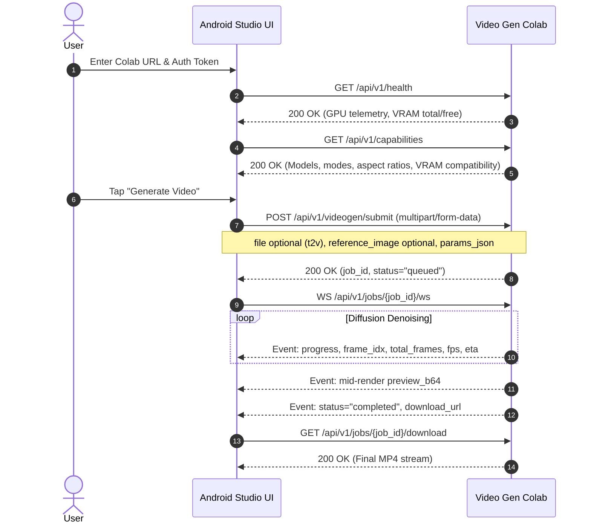

# Video Generation Studio Implementation Plan

## 1. Overview & Objectives

This plan specifies the end-to-end integration of the **Video Generation Studio** into the Upscaler Studio Android application, positioned directly below **Depth Map Studio** on the main dashboard (`HomeScreen`).

Based on your confirmed architectural choices:
1. **Dual-Backend Connection**: Defaults to the primary Colab backend with a clean toggle to switch to a **Dedicated Video Gen Colab** URL when running on a separate GPU instance.
2. **Dedicated Submission Route**: The backend exposes `/api/v1/videogen/submit`, leaving the existing `/api/v1/jobs/submit` 100% untouched to prevent regressions.
3. **Single-Tap Character Selection**: The Character Exchange tool uses a responsive single-tap coordinate selector (`mask_point_x`, `mask_point_y`) on the video preview frame, paired with backend GrabCut mask synthesis.

Inside the studio, the user interface provides **5 dedicated modality sections**:
* **Text-to-Video (`t2v`)**: AI video synthesis from text prompts (zero file upload required).
* **Image-to-Video (`i2v`)**: Bringing still photos to life with motion.
* **Video-to-Video (`v2v`)**: Stylization with optional Depth Anything V2 3D structural guidance.
* **Motion Copy (`motion_copy`)**: Re-animating a character image with motions extracted from a driving video.
* **Character Exchange (`character_exchange`)**: Replacing a person in a video using tap-targeted mask replacement.

---

## 2. System Architecture & Dual-Backend Topology

```mermaid
flowchart TD
    subgraph Android["Android App (Client)"]
        Nav["MainActivity NavHost"]
        Home["HomeScreen (Studio Grid)"]
        VGenScreen["VideoGenStudioScreen"]
        Repo["UpscalerRepository (Dual-Backend Manager)"]

        Home -->|Tap Studio Card| VGenScreen
        VGenScreen --> SubTabs{"5 Modality Tabs"}
        SubTabs --> T2V["Text to Video (t2v)"]
        SubTabs --> I2V["Image to Video (i2v)"]
        SubTabs --> V2V["Video to Video (v2v)"]
        SubTabs --> Motion["Motion Copy"]
        SubTabs --> Swap["Character Exchange"]
        
        VGenScreen --> EnvToggle["Backend Env Switcher"]
    end

    subgraph PrimaryColab["Primary Colab Backend (Enhancement)"]
        EnhanceAPI["/api/v1/jobs/submit (Upscale, RIFE, Denoise, Depth)"]
    end

    subgraph VideoGenColab["Dedicated Video Gen Colab (Generation)"]
        VGenAPI["/api/v1/videogen/submit (T2V, I2V, V2V, Motion, Swap)"]
        VRAMMgr["Singleton VRAM Manager"]
        DiffusersEngine["Wan 2.1 / 2.2 / Hunyuan / LTX"]
        
        VGenAPI --> VRAMMgr --> DiffusersEngine
    end

    EnvToggle -->|Toggle: OFF (Default)| EnhanceAPI
    EnvToggle -->|Toggle: ON (Dedicated)| VGenAPI
    Repo -.->|Active Connection| VGenAPI
```

---

## 3. Detailed Component Plan

### A. Navigation & Dashboard Integration

1. **Route Definition (`Screen.kt`)**:
   Add the new route object:
   ```kotlin
   object VideoGenStudio : Screen("studio_videogen")
   ```
2. **Dashboard Placement (`HomeScreen.kt`)**:
   Add `StudioItem` directly beneath Depth Map Studio:
   ```kotlin
   StudioItem(
       key = "videogen",
       title = "Video Gen Studio",
       description = "Text-to-Video, Image Animation, Character Swap & Motion Copy.",
       icon = Icons.Default.AutoAwesomeMotion,
       route = "studio_videogen",
       badge = "Wan 2.1/2.2 · Diffusers"
   )
   ```
3. **NavHost Registration (`MainActivity.kt`)**:
   Register `composable(Screen.VideoGenStudio.route) { VideoGenStudioScreen(...) }`.

---

### B. Dual-Backend Connection Strategy

The app will support dual connections with seamless fallback:

1. **Preferences Storage (`UpscalerRepository.kt`)**:
   * `KEY_VIDEOGEN_USE_DEDICATED`: Boolean (Default: `false` = inherit primary Colab URL).
   * `KEY_VIDEOGEN_BASE_URL`: String (Dedicated Colab ngrok/tunnel URL).
   * `KEY_VIDEOGEN_AUTH_TOKEN`: String (Dedicated Colab auth token).
2. **Repository Resolver Method**:
   ```kotlin
   fun getEffectiveVideoGenClient(): Pair<UpscalerApiService, JobWebSocketClient>
   ```
   * When `KEY_VIDEOGEN_USE_DEDICATED == false`: routes through the primary backend client.
   * When `KEY_VIDEOGEN_USE_DEDICATED == true`: routes through the dedicated Video Gen connection.
3. **In-Studio Environment Banner**:
   A compact status header at the top of `VideoGenStudioScreen`:
   * Status dot: 🟢 Connected (showing detected VRAM & GPU name) | 🟡 Connecting | 🔴 Disconnected.
   * Quick toggle: *"Use Dedicated Colab Instance"* with inline URL & Token input dialog.

---

### C. The 5 Modality Sub-Sections (`VideoGenStudioScreen.kt`)

A horizontal `ScrollableTabRow` switches between the 5 modalities, persisting draft inputs across tab switches:

#### 1. Text-to-Video (`t2v`)
* **Inputs**:
  * Prompt text area with one-tap style pills (*Cinematic, Anime, Cyberpunk, 3D Render*).
  * Expandable Negative Prompt field.
  * Aspect Ratio selector (`16:9`, `9:16`, `1:1`, `4:3`).
  * Duration chips (`3s`, `5s`, `8s`) and Resolution preset (`480p`, `720p`).
  * Model picker filtered by available VRAM (`wan21_t2v_1_3b`, `wan22_ti2v_5b`, `hunyuan_video_1_5`, `ltx25_av`, `wan22_t2v_14b`).
  * Hyperparameters: Steps (20–40, default 28), Guidance scale (3.0–7.0, default 5.0), Seed (-1 for random).
* **Network Call**: Submits `POST /api/v1/videogen/submit` with `params_json` and **no media file**.

#### 2. Image-to-Video (`i2v`)
* **Inputs**:
  * Media picker for a single starting image with interactive preview.
  * Optional motion prompt (e.g. *"Gentle breeze, blinking eyes, slow pan"*).
  * Aspect ratio & duration controls.
  * Model picker (`wan22_ti2v_5b`, `hunyuan_video_1_5`, `wan22_i2v_14b`).
* **Network Call**: Submits `file = <image_file>` + `params_json`.

#### 3. Video-to-Video (`v2v`)
* **Inputs**:
  * Source video picker with clip length verification (clamped to max 8 seconds).
  * Style prompt (e.g. *"Turn into retro 90s anime style"*).
  * Toggle: **"Depth Anything V2 Structural Guidance"** (enables Depth map conditioning for 3D temporal stability).
  * Audio toggle: **"Preserve Original Audio"** (`preserve_audio=true`).
  * Model picker (`wan21_vace_1_3b`, `wan21_vace_14b`).
* **Network Call**: Submits `file = <video_file>` + `params_json`.

#### 4. Motion Copy (`motion_copy`)
* **Inputs**:
  * Dual media selectors:
    1. **Driving Video**: Video providing the body motion or dance.
    2. **Character Image**: Picture of the avatar or character to animate.
  * Audio toggle (`preserve_audio`).
  * Model: `wan22_animate_14b`.
* **Network Call**: Submits `file = <driving_video>`, `reference_image = <character_image>` + `params_json`.

#### 5. Character Exchange (`character_exchange`)
* **Inputs**:
  * **Source Video**: Original video containing the person to swap.
  * **Replacement Character Image**: Picture of the replacement person/character.
  * **Single-Tap Interactive Target Picker**:
    * Displays the first frame of the source video in a touch-sensitive surface.
    * When the user taps the target person, a pulsing target reticle appears at $(x, y)$.
    * The normalized coordinates $(x/w, y/h)$ are recorded as `mask_point_x` and `mask_point_y`.
    * Backend uses these coordinates with OpenCV GrabCut to generate the segmentation mask automatically.
  * Audio toggle (`preserve_audio`).
  * Model picker (`wan21_vace_1_3b`, `wan22_animate_14b`).
* **Network Call**: Submits `file = <source_video>`, `reference_image = <character_image>` + `params_json` containing `mask_point_x` and `mask_point_y`.

---

### D. Live Progress, Preview & Export Pipeline

1. **WebSocket Denoising Stream**:
   * Uses the existing `JobWebSocketClient` connecting to `/api/v1/jobs/{job_id}/ws`.
   * Real-time progress display:
     * `0% - 10%`: Preparing inputs & model allocation.
     * `10% - 20%`: Video decoding & depth/mask conditioning.
     * `20% - 90%`: Diffusion steps with live step index (e.g. `Step 14/28`), inference FPS, and countdown ETA.
     * `90% - 100%`: VAE decoding & FFmpeg MP4 export.
2. **Intermediate Preview Card**:
   * Displays the mid-denoising thumbnail (`preview_b64`) directly inside the progress card.
3. **Controls**:
   * Real-time **Pause**, **Resume**, and **Cancel** buttons hooked into `/api/v1/jobs/{job_id}/pause` and `/cancel`.
4. **Playback & Chaining**:
   * Looping MP4 player via `TexturePlayerView` / ExoPlayer.
   * **Save to Gallery**: Directly saves the generated video to the device's public `Movies/UpscalerStudio` folder.
   * **Send to 4X Upscaler**: One-tap action that loads the generated video into the 2X/4X Super-Resolution studio so the user can upscale their AI clip to 4K 60FPS.

---

## 4. Backend Contract (For Your Dedicated Colab Backend)

Here is the exact API specification for the new Colab backend you will create:



### Endpoints Specification

1. **`GET /api/v1/health`**
   * Header: `Authorization: Bearer <token>`
   * Returns:
     ```json
     {
       "status": "ok",
       "gpu": {
         "available": true,
         "device": "NVIDIA A100-SXM4-40GB",
         "vram_total_mb": 40960.0,
         "vram_free_mb": 38120.0
       }
     }
     ```
2. **`GET /api/v1/capabilities`**
   * Returns `VIDEOGEN_MODELS`, available modes, aspect ratios, and durations matching [backend/models/videogen.py](file:///d:/programming%20work/4x%20upscaler/backend/models/videogen.py).
3. **`POST /api/v1/videogen/submit`**
   * Accepts:
     * `file: Optional[UploadFile] = File(None)` (None for `t2v`, primary media for other modes).
     * `reference_image: Optional[UploadFile] = File(None)` (Reference character photo for motion copy and character swap).
     * `params_json: str = Form(...)` (JSON string with mode, model, prompt, negative_prompt, aspect_ratio, duration_sec, seed, mask_point_x, mask_point_y, etc.).
     * `client_submission_id: Optional[str] = Form(None)`.
   * Enqueues job in `TaskJob` queue and returns `{"job_id": "...", "status": "queued"}`.
4. **`GET /api/v1/jobs/{job_id}/ws`**
   * WebSocket delivering snapshot and real-time step progress events.
5. **`GET /api/v1/jobs/{job_id}/download`**
   * Streams the exported MP4 file.

---

## 5. Implementation Phases & Work Breakdown

| Phase | Component | Targets | Deliverables |
| :--- | :--- | :--- | :--- |
| **Phase 1** | Navigation & Dual-Backend State | [Screen.kt](file:///d:/programming%20work/4x%20upscaler/android/app/src/main/java/com/upscaler/studio/ui/navigation/Screen.kt)<br>[HomeScreen.kt](file:///d:/programming%20work/4x%20upscaler/android/app/src/main/java/com/upscaler/studio/ui/home/HomeScreen.kt)<br>[UpscalerRepository.kt](file:///d:/programming%20work/4x%20upscaler/android/app/src/main/java/com/upscaler/studio/data/repository/UpscalerRepository.kt) | • Video Gen card added to `HomeScreen` below Depth Studio.<br>• Dual Colab connection storage with fallback toggle.<br>• Health check validation for both endpoints. |
| **Phase 2** | Retrofit API & Models | [Models.kt](file:///d:/programming%20work/4x%20upscaler/android/app/src/main/java/com/upscaler/studio/data/model/Models.kt)<br>[UpscalerApiService.kt](file:///d:/programming%20work/4x%20upscaler/android/app/src/main/java/com/upscaler/studio/data/api/UpscalerApiService.kt) | • Definition of `/api/v1/videogen/submit` supporting optional primary file and secondary reference image.<br>• Capabilities response parsing for Video Gen models. |
| **Phase 3** | Studio Screen & Modality Tabs | `VideoGenStudioScreen.kt`<br>[StudioComponents.kt](file:///d:/programming%20work/4x%20upscaler/android/app/src/main/java/com/upscaler/studio/ui/studios/StudioComponents.kt) | • Tab switcher for 5 modes (T2V, I2V, V2V, Motion Copy, Character Swap).<br>• Aspect ratio, duration, prompt chips, and model selection dropdown. |
| **Phase 4** | Touch Masking & Progress Integration | `VideoGenStudioScreen.kt`<br>[LiveProgressCard.kt](file:///d:/programming%20work/4x%20upscaler/android/app/src/main/java/com/upscaler/studio/ui/components/LiveProgressCard.kt) | • Single-tap coordinate capture on first video frame.<br>• Step-level progress display and WebSocket intermediate thumbnail rendering. |
| **Phase 5** | Player, Gallery & Upscaler Bridge | `VideoGenStudioScreen.kt` | • Result video playback.<br>• "Save to Gallery" MediaStore export.<br>• "Send to 4X Upscaler" shortcut to upscale the generated video. |
